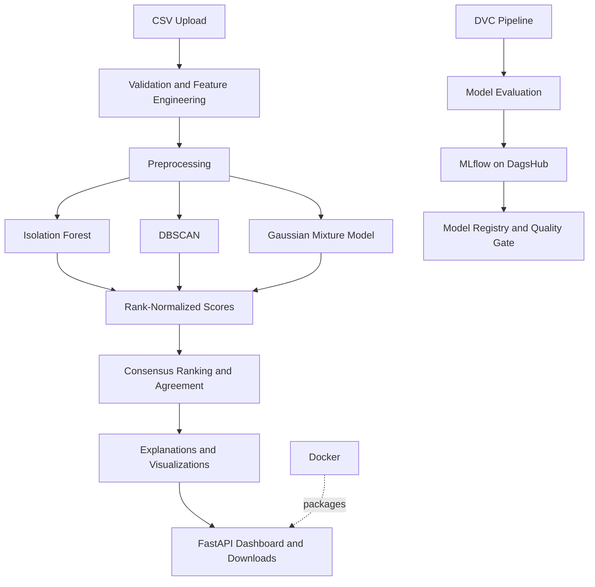

# Intelligent Anomaly Discovery Platform

Upload a CSV of industrial sensor readings and get back the most unusual rows, ranked, explained and ready to download. The system is **unsupervised**: it finds anomalies without needing failure labels to fit the detectors, then helps an analyst decide what deserves investigation.

It combines three different detectors (Isolation Forest, DBSCAN, Gaussian Mixture Model) into one consensus ranking, serves the result through a FastAPI web app, and ships with a reproducible DVC pipeline, MLflow tracking on DagsHub, a model registry with a quality gate, automated tests, and a Docker image.


> **An anomaly is not a confirmed fault.** A flagged row is a lead worth investigating. The project is built and evaluated on a *simulated* dataset, so the numbers below describe how the method behaves, not how it would perform in a real plant.

---

## At a glance

| Component | Details |
|---|---|
| Problem | Unsupervised industrial anomaly discovery |
| Dataset | AI4I 2020 Predictive Maintenance |
| Input | CSV with five required sensor columns |
| Detectors | Isolation Forest, DBSCAN, Gaussian Mixture Model |
| Consensus | Average of rank-normalized anomaly scores |
| Evaluation | 10 repeated stratified 80/20 splits |
| Consensus average precision | 0.405 ± 0.049 |
| Consensus ROC-AUC | 0.875 ± 0.016 |
| Web application | FastAPI |
| Pipeline | DVC |
| Experiment tracking and registry | MLflow on DagsHub |
| Deployment | Docker |
| Tests | pytest |

## Architecture



The experiment pipeline and upload workflow are separate. The web app fits the detectors on each uploaded file rather than loading permanently trained detector weights.

---

## Results

### Benchmark

The benchmark uses the [AI4I 2020 Predictive Maintenance Dataset](https://archive.ics.uci.edu/dataset/601/ai4i+2020+predictive+maintenance+dataset) (10,000 rows, 339 failures = 3.39%).

Failure labels are **never used to fit the unsupervised detectors**. They are used to construct stratified train/test splits and evaluate the resulting rankings, but not to optimize detector parameters or consensus weights.

All results below are the mean ± standard deviation over **10 repeated stratified 80/20 splits** (seeds 42 to 51). Everything is refitted on each split. Each test set holds about 68 failures. A random ranking has an expected average precision (AP) of approximately 0.034.

| Method | ROC-AUC | Average precision |
|---|---:|---:|
| Isolation Forest | 0.872 ± 0.013 | 0.295 ± 0.050 |
| DBSCAN | 0.809 ± 0.022 | 0.362 ± 0.056 |
| Gaussian Mixture | 0.856 ± 0.022 | 0.232 ± 0.044 |
| **Consensus (rank average)** | **0.875 ± 0.016** | **0.405 ± 0.049** |

- The consensus AP is about **12 times** the random baseline.
- The consensus had a higher AP than each single method on **all 10 splits** (mean gaps: +0.110 over Isolation Forest, +0.172 over GMM, +0.043 over DBSCAN). The gap over DBSCAN is small, only about 1.7 times its split-to-split variation. It is consistent but not large.
- On ROC-AUC the consensus ties with Isolation Forest. Its advantage is at the **top of the ranking**, where an analyst actually works.
- A single split can mislead. The seed-42 split gave a consensus AP of 0.348, well below the 10-split mean.

### Does every method earn its place? (ablation)

| Consensus variant | AP | Full consensus minus this variant | Splits won by the full consensus |
|---|---:|---:|---:|
| All three methods | 0.405 | n/a | n/a |
| Without GMM | 0.363 | +0.042 | 10 / 10 |
| Without DBSCAN | 0.397 | +0.008 | 5 / 10 |
| Without Isolation Forest | 0.353 | +0.051 | 10 / 10 |

GMM is the weakest method on its own, yet removing it costs 0.042 AP on average. It adds a different signal. DBSCAN adds little. It was kept because the rule fixed before the run (a variant must win on all 10 splits to replace the three-method design) was not met.

### When all three methods agree

Among the flagged rows (top 3% of each file), rows that **all three methods also rank near the top** were recorded failures **75% of the time (0.754 ± 0.088)**. The other flagged rows were failures **34% of the time (0.340 ± 0.053)**. The gap was positive on all 10 splits.

The app shows this as a "High confidence" badge. This means agreement between detectors, not a calibrated probability that a fault exists. These rates come from the AI4I benchmark and need not hold on other data.

### What reviewing the top rows looks like (one split, seed 42, 68 failures)

| Rows reviewed | Precision | Share of failures found |
|---|---:|---:|
| Top 1% | 0.65 | 0.19 |
| Top 3% | 0.37 | 0.32 |
| Top 5% | 0.29 | 0.43 |
| Top 10% | 0.18 | 0.53 |

By failure type, power failures are found completely (13 of 13 at the top 5%), while tool-wear failures (10 cases, recall 0.10) and random failures (4 cases, none found at 5%) are not. Random failures are random by design, and tool-wear failures leave little trace in these sensors.

### Check inside the app

Running the app on the full AI4I file (fitted on the 10,000 rows themselves, no labels used) gives a consensus ROC-AUC of 0.877 and AP of 0.388. That is consistent with the benchmark above, though it is the same data and not an independent test.

---

## How it works

### Features

- The five sensor columns plus two engineered features: `temp_diff` (process minus air temperature) and `power_W` (torque × angular speed, with angular speed converted from RPM to radians per second).
- Rotational speed and `power_W` are skewed, so they get a Yeo-Johnson transform. The rest are standardized. Transformers are fitted on the training data only during benchmark evaluation.
- Outliers are **kept**. Finding unusual rows is the goal, so removing them would remove what we are looking for.
- The machine `Type` (L/M/H) is **dropped**. It has little effect on sensor behaviour, and SHAP showed Isolation Forest using the one-hot column to isolate rows. Dropping it improved Isolation Forest (ROC-AUC 0.816 to 0.874 on the seed-42 split).

### Detectors

| Method | Setting | Score (higher = more unusual) |
|---|---|---|
| Isolation Forest | 300 trees | How easily the row is isolated |
| DBSCAN | `eps=1.0`, `min_samples=14` (chosen from a k-distance plot) | Distance-based score relative to dense core points |
| Gaussian Mixture | 7 components, full covariance (chosen at the BIC elbow) | Negative log-likelihood |

HDBSCAN was tested and dropped: its outlier scores agreed 92–93% with DBSCAN's at the top of the ranking, so it added little new information. K-Means was not used because it has no inherent notion of an anomaly.

The **consensus** is the average of the three rank-normalized scores. "Methods agree" counts how many of the three put a row in their own top group.

### Explanations

Each flagged row lists the features that sit furthest from typical (in standard deviations), and the top SHAP feature from Isolation Forest. Treat these as **clues, not causes**: speed, torque and power are mathematically linked, so one underlying cause can show up as all three.

---

## The web app

Upload a CSV, choose what fraction of rows to flag (default 3%, up to 20%), and get:

- Counts of **High confidence** (all three methods agree), **Review** (flagged, fewer agree) and **Not flagged** rows.
- A score histogram with the cutoff, a 2D PCA view of flagged vs normal rows, and a product-type breakdown.
- A searchable, filterable table of flagged rows with raw sensor values and explanations.
- Notices when results may be less reliable (small file, imputed values, DBSCAN settings that do not suit the data).
- If your file has a 0/1 `Machine failure` column, a check of how well each score ranks it (never used for fitting).
- Downloads: flagged rows (CSV), all scores (CSV), summary statistics (JSON).

**Input:** a CSV (comma, semicolon or tab separated) with the columns `Air temperature [K]`, `Process temperature [K]`, `Rotational speed [rpm]`, `Torque [Nm]` and `Tool wear [min]`. Other columns are ignored, and `UDI` / `Product ID` are carried into the report.

The app accepts 500 to 20,000 rows and up to 10 MB. Missing values are replaced by the column median, and a column with more than 30% missing values is rejected.

**Safety:** text from your file is escaped before it appears in the page, spreadsheet-formula cells (`=`, `+`, `-`, `@`) are neutralized in CSV downloads, and the container runs as a non-root user. Results live in memory for one hour (at most 20 at a time) and nothing is intentionally written to disk.

**Do not upload confidential data.**

Each upload is analysed on its own: the models are fitted on *your file*, so scores are ranks within that file and cannot be compared between files.

---

## Quick start

There are two ways to run the application: **with Docker** or **locally with Python and Uvicorn**.

### Option 1: Run with Docker

The published image is available on [Docker Hub](https://hub.docker.com/r/amiitkr/intelligent-anomaly-discovery).

Pull the image:

```bash
docker pull amiitkr/intelligent-anomaly-discovery:latest
```

Run the container:

```bash
docker run --rm -p 8000:8000 amiitkr/intelligent-anomaly-discovery:latest
```

Open [http://localhost:8000](http://localhost:8000).

To check the health endpoint, open [http://localhost:8000/health](http://localhost:8000/health). Interactive API documentation is available at [http://localhost:8000/docs](http://localhost:8000/docs).

The first start may take up to a minute. The image contains the application and runtime dependencies, but no benchmark dataset or secrets.

To stop the container, press `Ctrl+C` in the terminal running the command. Because the command uses `--rm`, Docker removes the container when it stops.

### Option 2: Run locally with Uvicorn

**Requirements:** Python 3.11 and Conda (or another Python environment manager).

Create and activate the environment:

```bash
conda create -n anomaly python=3.11 -y
conda activate anomaly
```

Install the project dependencies:

```bash
pip install -r requirements.txt
pip install -e .
```

Start the FastAPI application:

```bash
uvicorn app.main:app --reload
```

Open [http://localhost:8000](http://localhost:8000).

Useful URLs:

- Dashboard: [http://localhost:8000](http://localhost:8000)
- Interactive API documentation: [http://localhost:8000/docs](http://localhost:8000/docs)
- Health check: [http://localhost:8000/health](http://localhost:8000/health)

Stop the local development server with `Ctrl+C`.

`--reload` is intended for local development. For a normal single-process run without automatic reloading, use:

```bash
uvicorn app.main:app --host 0.0.0.0 --port 8000
```

The app fits the detectors on each uploaded file; it does not require pre-trained detector weights. Run it with **one worker**, because results are kept in memory.

---

## API

Interactive documentation is available at `/docs`.

| Endpoint | Purpose |
|---|---|
| `POST /api/analyze` | Upload a CSV (`file`) and a fraction (`review_pct`, e.g. `0.03`); returns a job ID and the summary |
| `GET /api/results/{job_id}` | Summary and flagged rows (`?limit=`) |
| `GET /api/results/{job_id}/plots` | Histogram and PCA data |
| `GET /report/{job_id}/flagged.csv` | Download flagged rows |
| `GET /report/{job_id}/all_scores.csv` | Download all scores |
| `GET /report/{job_id}/summary.json` | Download summary statistics |
| `GET /health` | Health status and configured model version |

---

## Reproducing the experiments

Place `ai4i2020.csv` (UCI dataset ID 601) at:

```text
data/raw/ai4i2020.csv
```

DVC tracks the data and pipeline artifacts, so a fresh clone does not necessarily contain the dataset. Obtain the dataset before reproducing the experiments.

Run the pipeline from the project root:

```bash
dvc repro
dvc dag
dvc metrics show
```

- Stages rerun only when their code, dependencies or parameters change.
- All settings are in `params.yaml`.
- The evaluation stage logs parameters, metrics, a precision-recall plot and the model to **MLflow on DagsHub**.
- The multi-seed stage runs 10 splits and writes mean ± standard deviation, paired differences between methods, the ablation and the agreement analysis.

### DagsHub configuration

Put your DagsHub token in a local `.env` file, if that is how your environment is configured:

```text
DAGSHUB_TOKEN=your_token_here
```

Never commit secrets. Make sure your tracking setup loads the token correctly.

Change `repo_owner` and `repo_name` in `src/model/model_evaluation.py` and `src/model/register_model.py` if you want to use your own DagsHub repository.

---

## Model registry

The registered model is the whole **method**: code, settings and benchmark evidence, saved as one MLflow model. The app fits the detectors on each upload, so there are no permanently trained detector weights to register.

Register a model:

```bash
python -m src.model.register_model
```

Promote the version currently assigned to `staging` to `production`:

```bash
python -m src.model.register_model --promote
```

A model is registered only if its mean consensus AP is at least 0.30 and it beats each single method on at least 9 of the 10 splits.

Every version is loaded once before it can become `staging`, so a version that cannot be loaded never gets the alias. Versions are tagged with their metrics and Git commit.

---

## Docker development and deployment

The Docker configuration is stored in the `docker/` directory:

```text
docker/
├── Dockerfile
├── docker-compose.yaml
├── requirements-docker.txt
└── .dockerignore
```

The Compose build context is the project root, so the Dockerfile can copy `src/`, `app/` and `params.yaml` into the image. Ensure the Docker ignore rules are configured for this build context.

Build the image:

```powershell
docker compose -f docker/docker-compose.yaml build
```

Build and start the application in the background:

```powershell
docker compose -f docker/docker-compose.yaml up --build -d
```

Check the container status:

```powershell
docker compose -f docker/docker-compose.yaml ps
```

View the application logs:

```powershell
docker compose -f docker/docker-compose.yaml logs -f app
```

Stop and remove the container:

```powershell
docker compose -f docker/docker-compose.yaml down
```

The image runs as a non-root user, exposes port `8000`, and includes a health check for `/health`. The Compose configuration limits container memory to 2 GB and runs a single Uvicorn worker.

`MODEL_VERSION` is an application configuration value, while the Docker image tag is separate. Set them consistently if you want `/health` to report a particular release identifier.

---

## Tests

Run the test suite from the project root:

```bash
pytest
```

The tests cover the preprocessing and scoring pipeline, API and pages, error cases, upload limits, HTML escaping and model registry behaviour against a local MLflow registry.

The registry tests cover the quality gate, version registration and aliases, promotion, prediction consistency, integer sensor columns, per-call review thresholds, loading in a fresh process, and rejection of an invalid model version without replacing the current staging alias.

---

## Design decisions

- **Fit on the uploaded file.** There is no train/serve gap and nothing to keep in sync, at the cost of scores that are only comparable within one file.
- **Rank averaging for the consensus.** The three scores live on different scales, and ranks combine them without tuning weights.
- **Report uncertainty, not single numbers.** With about 68 failures per test set, one split can move AP by more than the gap between methods. Results are repeated over 10 splits, with paired differences.
- **Decision rules set before running.** For example, a two-method consensus replaces the three-method one only if it wins on all 10 splits.
- **Quality gate before registration.** A parameter change that makes the method worse cannot silently become the `staging` version.

---

## Limitations

- **Simulated data.** The labels are a proxy for unusual behaviour, and an anomaly is not necessarily a failure.
- **Small test sets and overlapping splits.** The 10 splits are drawn from the same 10,000 rows and are not independent, so the reported standard deviations understate the true uncertainty.
- **Some design choices were made after looking at labels** on one split: dropping `Type` and adding `power_W`. The reasons (EDA and SHAP) did not depend entirely on labels, but the decisions came after seeing a first round of results. `power_W` was chosen knowing that power failures in this dataset depend on torque × speed, which is why power failures are found so well. The minimum file size was set from a label-based size sweep.
- **GMM can absorb a tight group of similar anomalies** as a "normal" mode. In a synthetic test, ten identical anomalous rows were ranked as the most normal in the file. GMM is also the least stable method across random seeds (rank correlation 0.89 to 0.96, against 0.99 for Isolation Forest).
- **File size matters.** The DBSCAN settings were tuned on about 8,000 rows. The share of rows it marks as noise depends on the file size (about 91% at 500 rows, 43% at 1,000, 14% at 2,000 and 4% at 5,000). The consensus AP averaged about 0.4 at every size from 500 to 5,000 rows, but varied far more from file to file for files under 2,000 rows (standard deviation about 0.08 to 0.09, against 0.01 to 0.02 above). The app shows a notice for small files.
- **Some failure types cannot be detected** from these sensors (random failures, most tool-wear failures).
- **The "High confidence" figures (75% vs 34%) come from the AI4I benchmark.** They need not hold on other data.
- **Single process, no authentication, in-memory results.** This is a portfolio application, not a production service.

---

## Tech stack

Python 3.11 · pandas · NumPy · SciPy · scikit-learn · SHAP · FastAPI · Uvicorn · Jinja2 (pages and charts in plain HTML, CSS and JavaScript) · DVC · MLflow on DagsHub · Docker · pytest

## Data and credits

Dataset: AI4I 2020 Predictive Maintenance Dataset, S. Matzka, UCI Machine Learning Repository (ID 601). It is a synthetic dataset that mimics industrial milling machines.

Built by [AmitKr-06](https://github.com/AmitKr-06). Experiments are tracked on [DagsHub](https://dagshub.com/AmitKr-06/Intelligent-anomaly-discovery), and the image is on [Docker Hub](https://hub.docker.com/r/amiitkr/intelligent-anomaly-discovery).
